

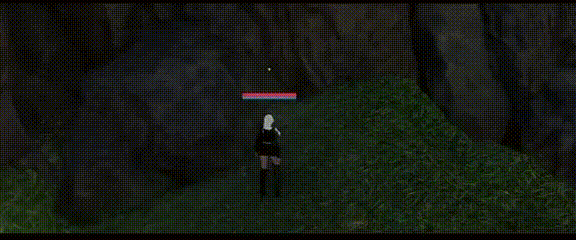

**Hidden Cube Finder.** Press <kbd>Ctrl</kbd>+<kbd>F9</kbd> and the arrow points at the nearest Hidden Cube around you, with its distance and height.

 

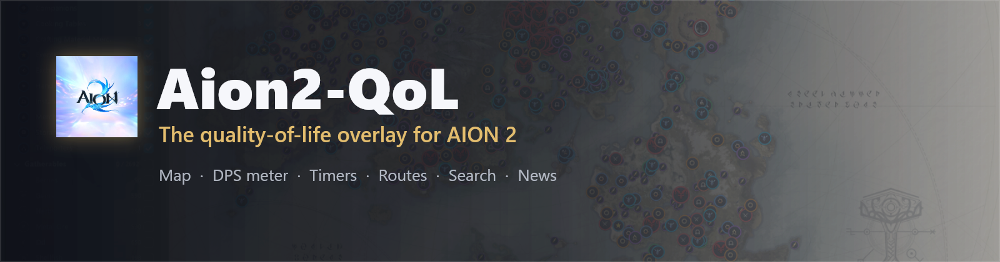

  

 

**A quality-of-life overlay for AION 2: interactive map, live DPS meter with party check, event timers, routes, pet farming and game news, one key away.**

---

## Contents

[What's new](#whats-new) · [Features](#features) · [Screenshots](#screenshots) · [Install](#install) · [Shortcuts](#shortcuts) · [Updates](#updates) · [Privacy and safety](#privacy-and-safety) · [Troubleshooting](#troubleshooting) · [FAQ](#faq) · [Changelog](CHANGELOG.md)

## What's new

**1.8.3**

- **Pet spots on Reshanta.** The map now shows where to farm pet souls on Reshanta: Karnif, Skama, Coradon, Slink, Young Slink, Klaw, Kalgolem, Agrint, Zelophi, Nepenthes, Swarm and Slime. They work with the pet farm list, the map filter and the guide arrow like the pets of Verteron and Altgard. Pets whose monsters we cannot match with certainty are not shown yet.
- **Reshanta showed every pet as "all maxed".** The pet picker said "all maxed" for any type with no known spots on the chosen map. It now says "no spots yet", and "all maxed" only appears when the pets really are finished.

Full list in the [changelog](CHANGELOG.md).

## Features

| | |
|---|---|
| **Interactive map** | Altgard, Reshanta and Verteron with thousands of markers: bosses, named monsters, dungeons, portals, merchants, quests, gathering points and pets. Open it in game with <kbd>Right Shift</kbd>+<kbd>M</kbd> (every shortcut can be changed in the Keybinds card). |
| **Filters and progress** | Grouped categories with counters. Mark markers as found, hide what you finished, and keep your progress between sessions. |
| **Routes** | Add stops with <kbd>R</kbd> or build a route from the resources, feathers or cubes you pick, with the shortest path. Skip, go back, re-plan or repeat it, detour to Hidden Cubes on the way, and save routes to reuse them. <kbd>Ctrl</kbd>+<kbd>F11</kbd> skips a stop. |
| **Live DPS meter** | Damage per second, share and crit rate per player. Solo or party scope, top 5 plus your own rank, boss and overall views, dungeon run history (including Shattered Arkanis and Deus Research Base) and per-skill detail. |
| **Event timers** | Shugo, Dimensional Invasion, Rift, Kaira, Siege, Nahma, daily and weekly resets, plus FPS, ping, server time and an optional CPU / GPU load row. |
| **Party check** | A card opens when you join a party and lists every member with class, level, server, gear score and combat power. It closes by itself in expeditions and Transcendence dungeons. |
| **Party QoL** | The map toolbar's *Party QoL* menu switches the party check on or off. When it is off the popup is disabled completely. |
| **Hidden Cube finder** | <kbd>Ctrl</kbd>+<kbd>F9</kbd> points the waypoint arrow at the nearest Hidden Cube around you (about 100 m). |
| **Minimap and waypoint arrow** | A live minimap in the corner and a redesigned 3D arrow that points at your current target, with distance and height difference. |
| **Pet farm list** | <kbd>Ctrl</kbd>+<kbd>F5</kbd> shows the pets you are farming with live souls. Pick them by type and map, click one for a ping, the arrow and the nearest teleporter, and the next closest pet is guided when one is maxed. |
| **Keybinds** | The map's *Keybinds* button lists every shortcut. Click one, press the new keys and it is rebound; a circular arrow restores the default. The map opens with <kbd>Right Shift</kbd>+<kbd>M</kbd> by default. |
| **Widgets** | The map's *Widgets* button lets you move every widget on a grid with magnetic centre lines, switch each one on or off, and save. Click-through mode keeps the overlay out of your way. |
| **Game news** | Patch notes, events and maintenance without leaving the game, with how long ago each was posted. |
| **Map shortcuts** | Update, changelog, GitHub and issues buttons sit at the bottom right of the map. |
| **Map button** | A small round button with the app icon floats over the game: click it to open or close the map, drag it anywhere. It hides while a game menu is open. |
| **Starts by itself** | Install it once. It starts with Windows, waits quietly in the tray and is ready the moment AION 2 opens. |
| **Stays running** | Runs as administrator without a manual step, and restarts itself if it ever crashes while the game is still open. |
| **Auto-update** | New versions are downloaded in the background and verified with a digital signature before they are applied. |

## Screenshots

<table>
<tr>
<td width="50%">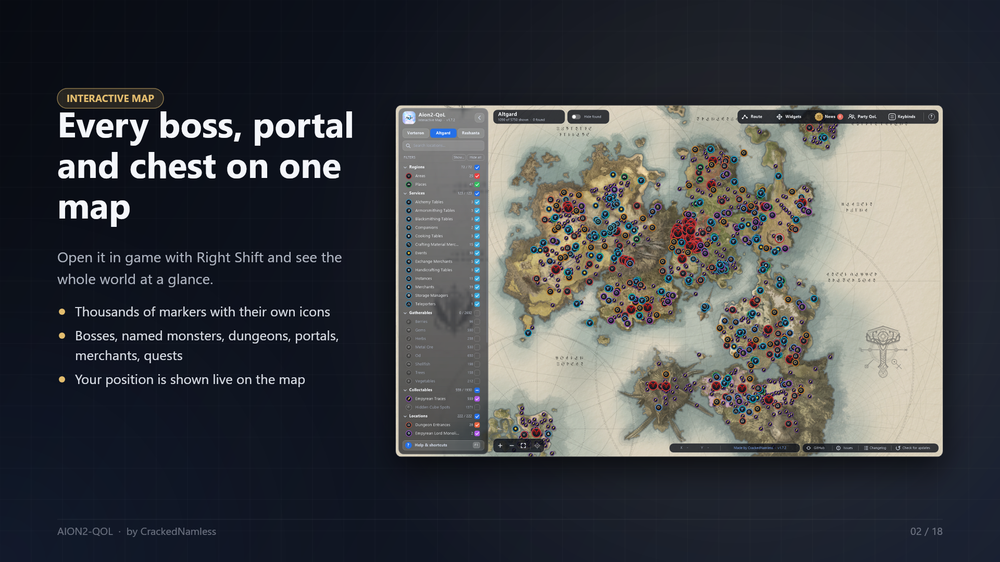 <b>Interactive map</b>: every boss, portal and chest.</td>
<td width="50%">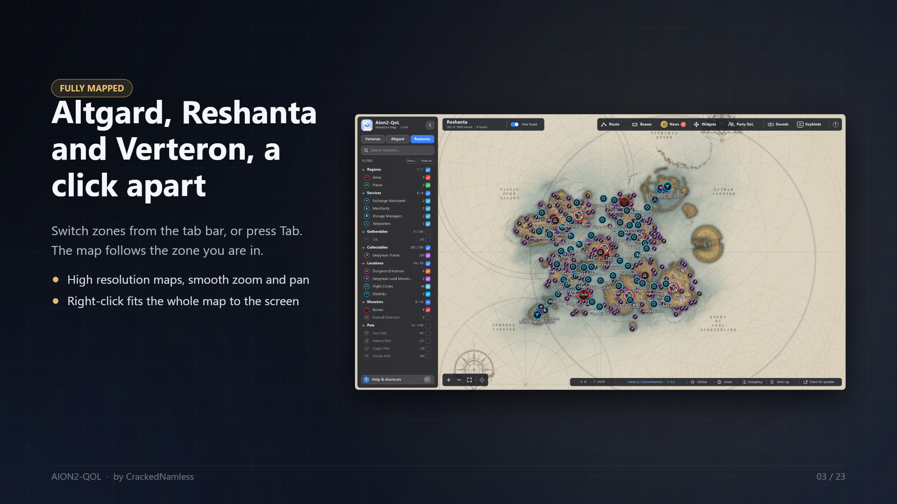 <b>Altgard, Reshanta and Verteron</b>, a click apart.</td>
</tr>
<tr>
<td width="50%">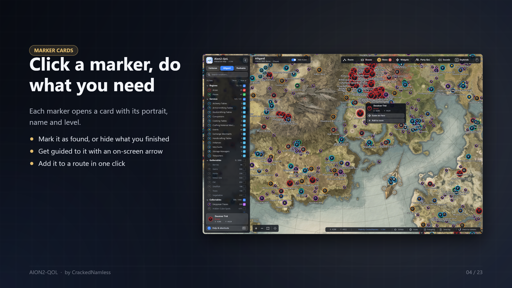 <b>Marker cards</b>: found, guide arrow, add to route.</td>
<td width="50%">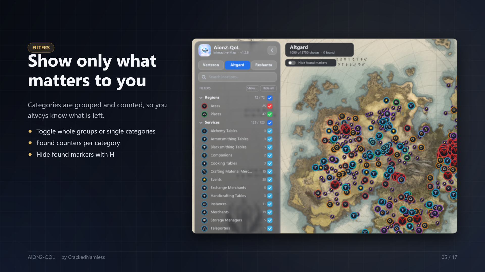 <b>Filters</b> with found counters.</td>
</tr>
<tr>
<td width="50%">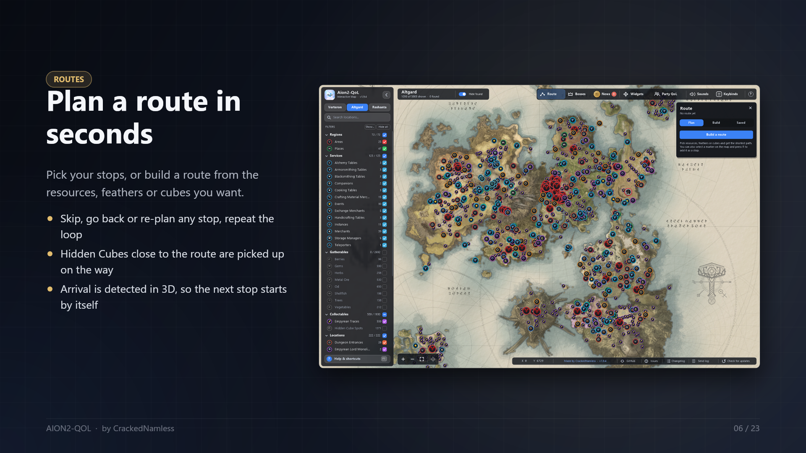 <b>Routes</b> planned in seconds.</td>
<td width="50%">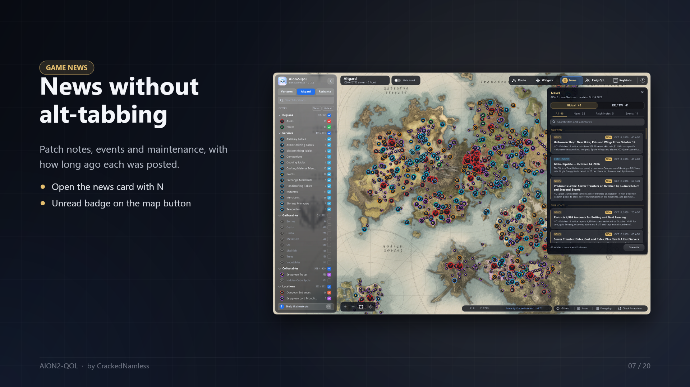 <b>Game news</b> without alt-tabbing.</td>
</tr>
<tr>
<td width="50%">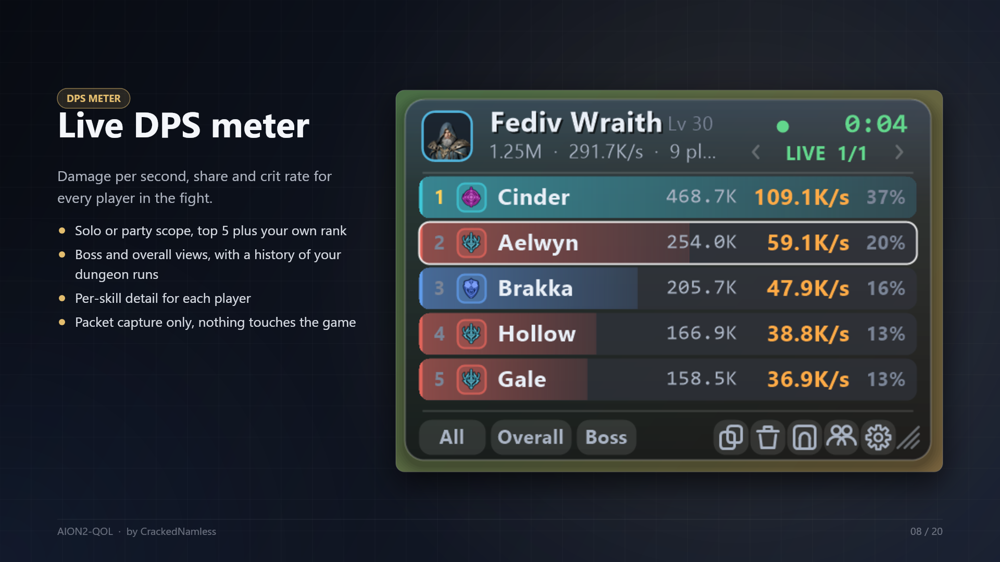 <b>Live DPS meter</b>.</td>
<td width="50%">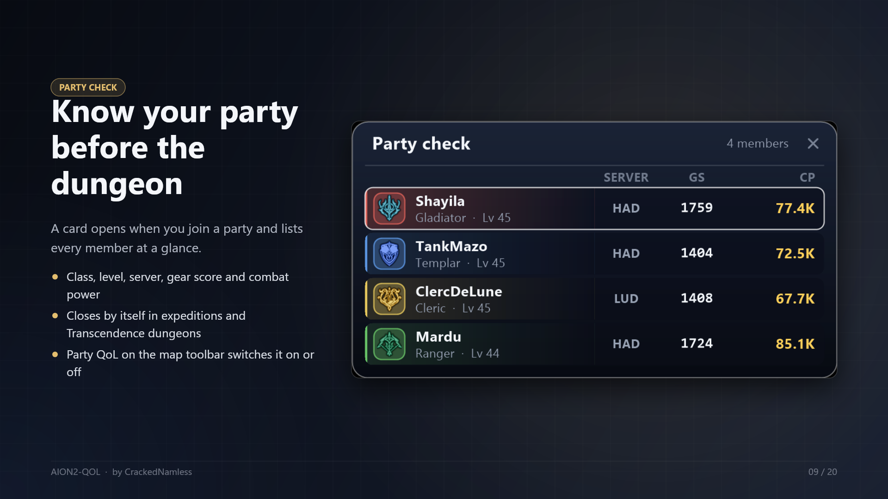 <b>Party check</b> before the dungeon.</td>
</tr>
<tr>
<td width="50%">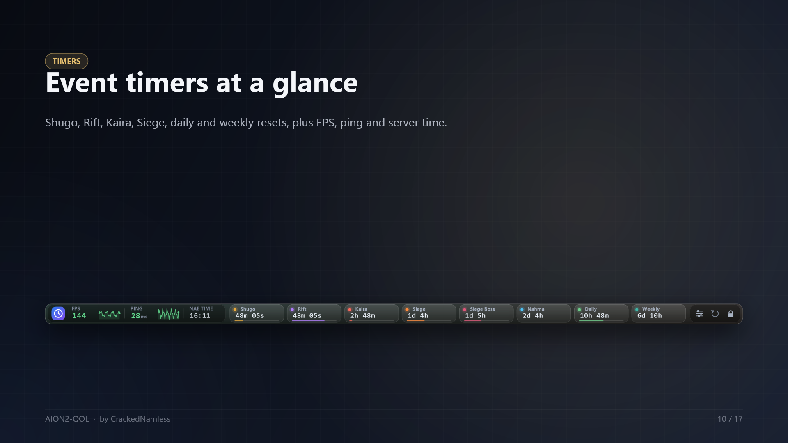 <b>Event timers</b> with CPU / GPU load.</td>
<td width="50%">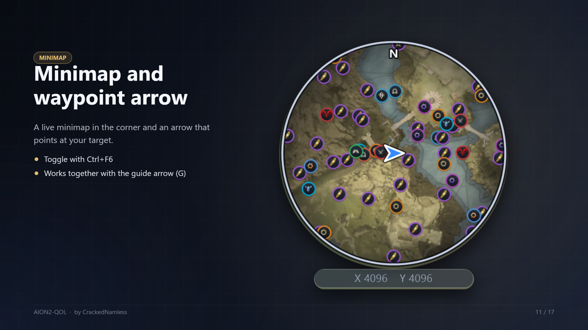 <b>Minimap</b> and waypoint arrow.</td>
</tr>
<tr>
<td width="50%">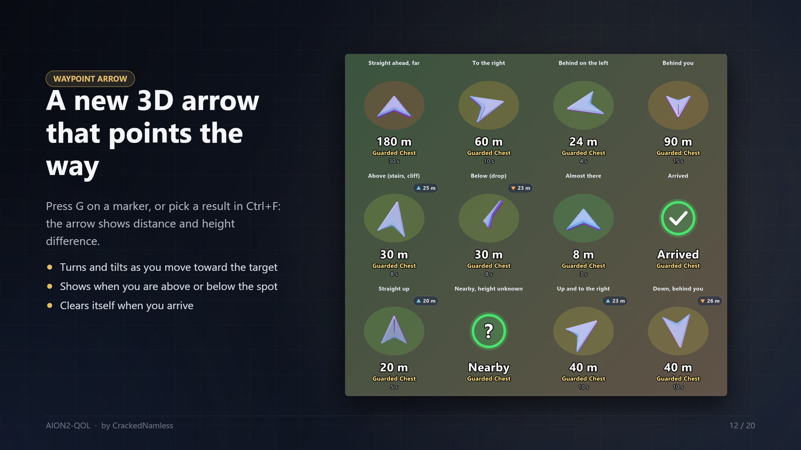 <b>New 3D arrow</b> with distance and height.</td>
<td width="50%">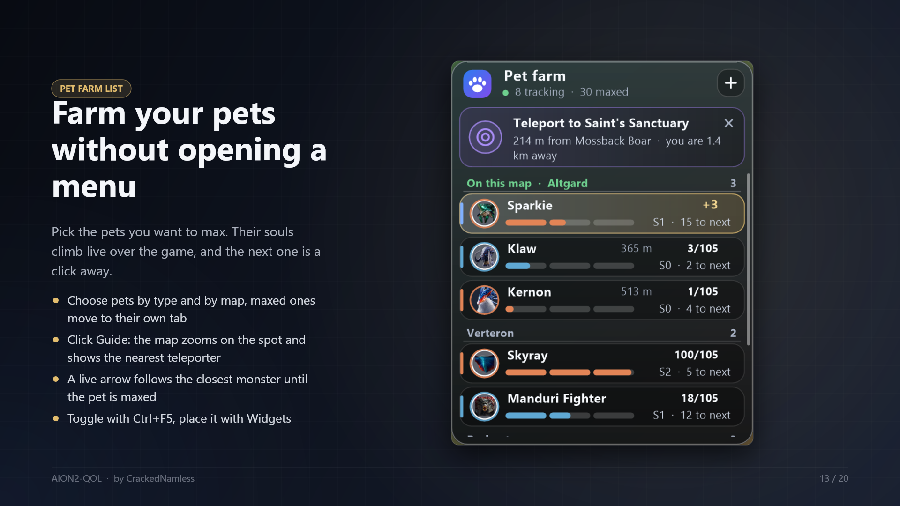 <b>Pet farm list</b> with guided farming.</td>
</tr>
<tr>
<td width="50%">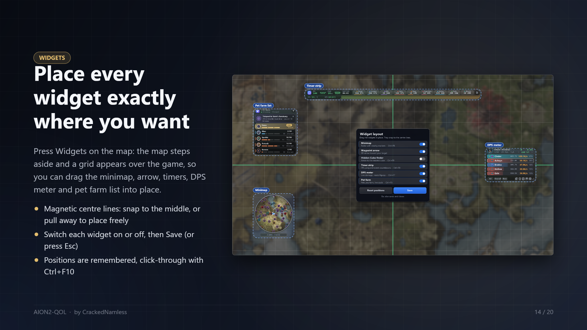 <b>Widgets</b>: place every widget.</td>
<td width="50%">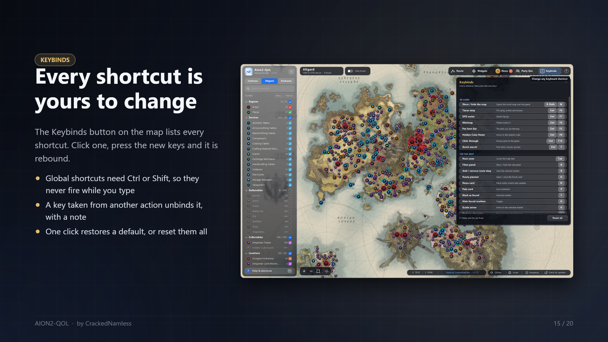 <b>Keybinds</b>: change every shortcut.</td>
</tr>
<tr>
<td width="50%">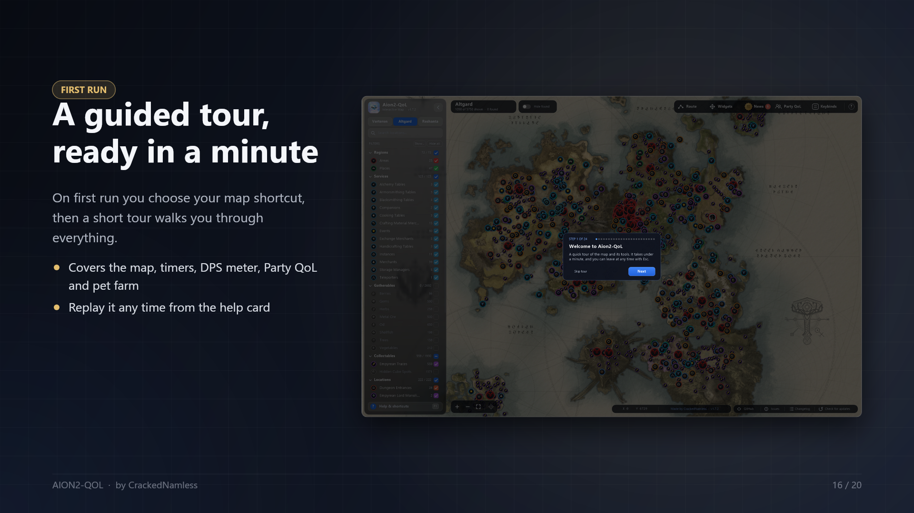 <b>Guided tour</b> on first run.</td>
<td width="50%">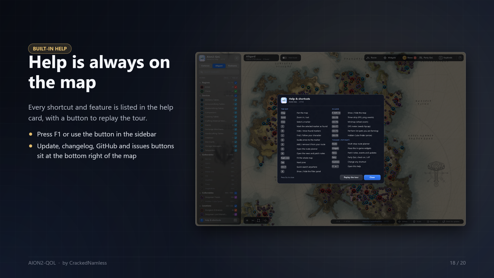 <b>Built-in help</b> on the map.</td>
</tr>
<tr>
<td width="50%">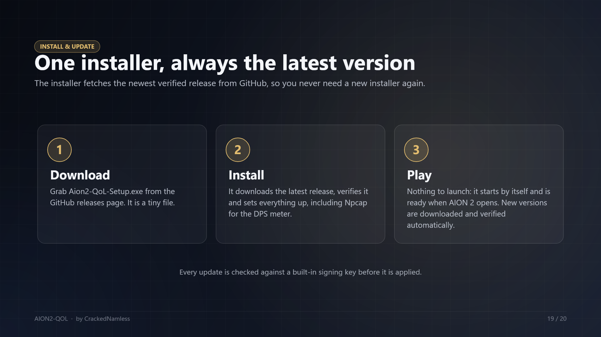 <b>One installer</b>, always the latest version.</td>
<td width="50%">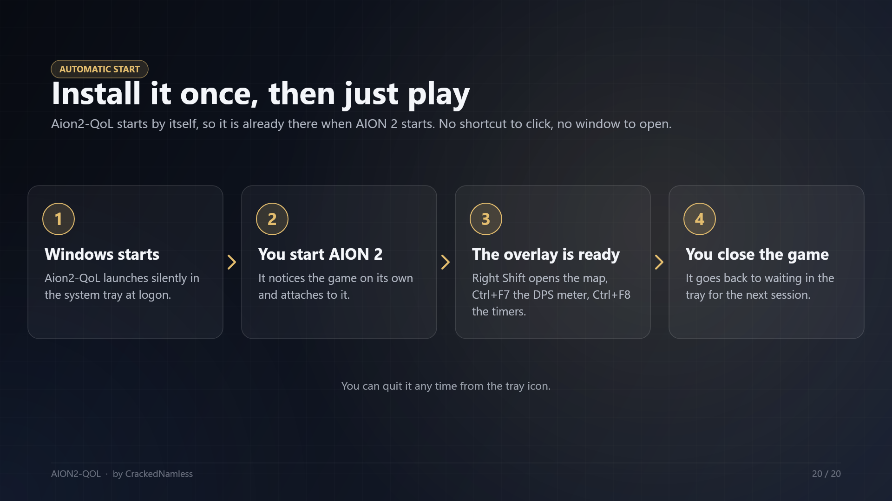 <b>Starts by itself</b> when you play.</td>
</tr>
</table>

## Install

1. Download **Aion2-QoL-Setup.exe** with the button above and run it.
2. The installer downloads the **latest release** from GitHub, checks its digital signature and installs it. It is a small file because it always fetches the newest version, so this is the only installer you will ever need. The first install downloads about 190 MB (maps and icons).
3. It installs [Npcap](https://npcap.com) for the DPS meter if you do not have it, and sets Aion2-QoL to **start by itself** with Windows. It runs silently in the system tray and picks up AION 2 as soon as the game opens, so there is nothing to launch before you play.
4. Start AION 2 and press <kbd>Right Shift</kbd>+<kbd>M</kbd>. A guided tour of the map, party check, timers and DPS meter opens the first time (replay it from <kbd>F1</kbd>).

**Requirements:** Windows 10 or 11 (64-bit), AION 2 running in borderless or windowed mode so the overlay can draw above it.

**Uninstall:** *Settings > Apps*. Your settings live in the install folder and are removed with it.

## Shortcuts

Global hotkeys work in game. Map keys work while the map is open, and <kbd>F1</kbd> on the map shows this list. All of them can be rebound from the *Keybinds* button on the map toolbar.

| Key | Action | | Key | Action |
|---|---|---|---|---|
| <kbd>Right Shift</kbd>+<kbd>M</kbd> | Open or close the map | | <kbd>Scroll</kbd> | Zoom |
| <kbd>Ctrl</kbd>+<kbd>F11</kbd> | Skip route stop | | <kbd>Drag</kbd> | Pan the map |
| <kbd>Ctrl</kbd>+<kbd>F5</kbd> | Pet farm list | | <kbd>Click</kbd> | Select a marker |
| <kbd>Ctrl</kbd>+<kbd>F6</kbd> | Minimap | | <kbd>P</kbd> | Pets card |
| <kbd>Ctrl</kbd>+<kbd>F7</kbd> | DPS meter | | <kbd>F</kbd> | Mark as found |
| <kbd>Ctrl</kbd>+<kbd>F8</kbd> | Event timers | | <kbd>H</kbd> | Hide found markers |
| <kbd>Ctrl</kbd>+<kbd>F9</kbd> | Hidden Cube finder | | <kbd>G</kbd> | Guide arrow to the selection |
| <kbd>Ctrl</kbd>+<kbd>F10</kbd> | Click-through mode | | <kbd>L</kbd> | Follow the player |
| <kbd>F1</kbd> | Help and shortcuts | | <kbd>R</kbd> / <kbd>O</kbd> | Add route stop / route planner |
| <kbd>Tab</kbd> | Next zone | | <kbd>N</kbd> | News |
| <kbd>B</kbd> | Side panel | | Right-click | Fit the map to the screen |

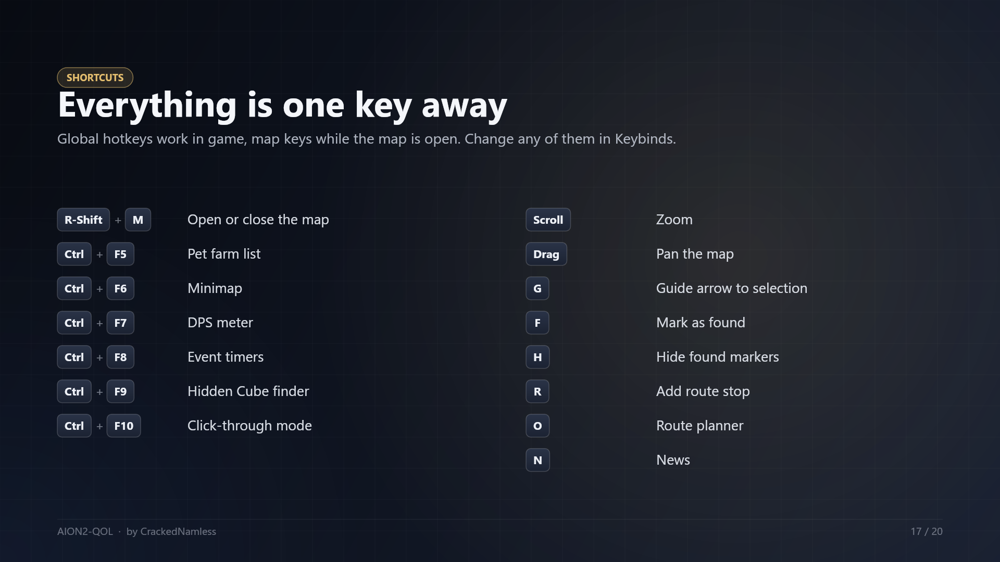

## Updates

Aion2-QoL checks GitHub for a new release when it starts. If one exists it downloads only the parts that changed, verifies them against the signed manifest and applies them. Nothing is installed from a release whose signature does not match the key built into the program. Release notes for every version are on the [Releases](https://github.com/CrackedNamless/Aion2-QoL/releases) page.

## Privacy and safety

- **DPS meter:** reads your own network traffic through Npcap (packet capture). It does not touch the game process.
- **Player position and minimap:** read from the game's memory in read-only mode. Nothing is injected into the game and no input is sent to it.
- **Map, routes, news:** local data shipped with the program and refreshed through updates.
- **Online heights:** optional and anonymous, crowd-sourced terrain heights used to place the player more precisely. No account, no personal data.
- **Updates:** every package is checked against an ECDSA signature whose public key is built into the program, so a tampered update is rejected.
- **Windows warnings:** the installer and the program are not signed with a paid certificate, so Windows may show a SmartScreen or "unknown publisher" prompt the first time. This is expected for a small independent project: choose *More info > Run anyway*.

Aion2-QoL is a fan-made tool and is **not affiliated with NCSOFT**. AION is a trademark of its respective owners. Third-party tools can be restricted by a game's rules: use it at your own risk.

## Troubleshooting

| Problem | What to do |
|---|---|
| The overlay does not appear | Run AION 2 in borderless or windowed mode, then press <kbd>Right Shift</kbd>+<kbd>M</kbd>. Check that the Aion2-QoL icon is in the system tray. |
| The DPS meter shows nothing | Make sure Npcap is installed (the installer offers it) and that you are in a fight. Press <kbd>Ctrl</kbd>+<kbd>F7</kbd> to toggle it. |
| The overlay blocks my mouse | Press <kbd>Ctrl</kbd>+<kbd>F10</kbd> for click-through mode. |
| A widget is in the wrong place | Open the map, press *Widgets*, drag it where you want, then Save. |
| Windows shows a SmartScreen warning | Choose *More info > Run anyway*, see [Privacy and safety](#privacy-and-safety). |

Still stuck? Open an [issue](https://github.com/CrackedNamless/Aion2-QoL/issues/new/choose) and describe what you see.

## FAQ

**Is it free?** Yes.

**Do I have to start it every time?** No. It starts with Windows and attaches to AION 2 on its own. To quit it use the tray icon.

**Do I need to download a new installer after each update?** No. The program updates itself and the installer always fetches the newest release.

**How do I turn the party check off?** Open the map, click *Party QoL* in the toolbar and switch *Party check* off. It then stays disabled until you switch it on again.

**Where do I report a problem or suggest something?** Open an [issue](https://github.com/CrackedNamless/Aion2-QoL/issues/new/choose). Bug reports and feature requests each have a short form.

## License

Aion2-QoL is free to use but closed source. See [LICENSE](LICENSE) for the terms.

---

Made by <b>CrackedNamless</b>

